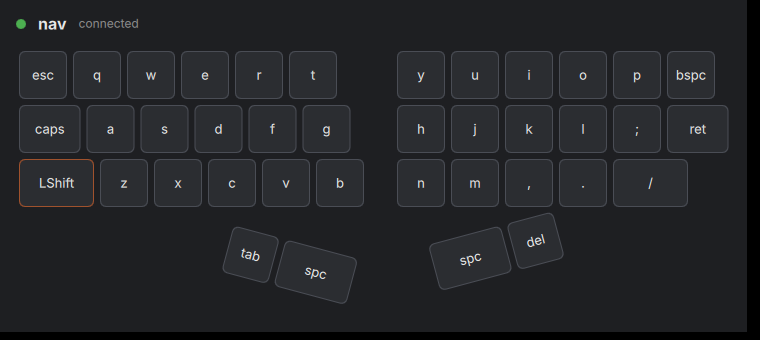

# kanata-overlay

An on-screen overlay for the [Kanata](https://github.com/jtroo/kanata) keyboard remapper:
it draws **your** physical keyboard and shows what each key does on the active layer.
Rust + Qt 6/QML (via [cxx-qt](https://github.com/KDAB/cxx-qt)), built for KDE Plasma.



*Current state: an always-on-top, click-through overlay (KDE Plasma Wayland; best
effort on X11). It imports a KLE layout, connects to Kanata's TCP server and shows the
active layer, and labels each key with its action from your `.kbd` config.*

## Why a layout designer?

Kanata's config says *which* keys exist (`defsrc`) but not *where* they are. The app
needs the physical geometry, so each key in a layout carries its position, size,
rotation and the Kanata key name that links it to `defsrc`:

```
physical key ──kanata name──▶ index in defsrc ──▶ action in the active deflayer
```

Layouts can be imported from [keyboard-layout-editor.com](https://www.keyboard-layout-editor.com/)
JSON; obvious legends (`Q`, `Esc`, `Caps Lock`…) are bound automatically and unbound
keys are outlined in orange. The [layout editor](#layout-editor) binds the rest and
shapes a board to match the device.

## Quick start

Requires [Nix](https://nixos.org/download) with flakes enabled.

```sh
nix develop            # or: direnv allow
just fake-kanata nav   # terminal 1: fake Kanata, no permissions needed
just run               # terminal 2: the overlay
```

With real Kanata:

```sh
just check-perms       # can Kanata run without root? (see below)
just run               # no Kanata running? the overlay starts and supervises one itself
LAYOUT=path/to/your-kle.json just run   # your own board
just kanata            # or run Kanata yourself (terminal 1); `just run` then attaches
just watch             # print raw TCP events
```

Run `just` for every task. On non-NixOS distros, if Qt Quick fails to create an
OpenGL context from the Nix shell, run the app through
[nixGL](https://github.com/nix-community/nixGL) or with `QT_QUICK_BACKEND=software`.

## Using the overlay

The overlay never takes focus or input: keep typing and clicking through it.

| Shortcut | Action |
| --- | --- |
| **Meta+Ctrl+K** | Show / hide the overlay |
| **Meta+Alt+Shift+K** | Open the settings window (position: edge or corner, margin, opacity, scale, monitor) |

Both can be rebound in *System Settings › Shortcuts › Kanata Overlay*. Settings are
saved to `$XDG_CONFIG_HOME/kanata-overlay/settings.json` (usually
`~/.config/kanata-overlay/settings.json`). Override them for one run without touching
the file:

```sh
just run --edge bottom-right --margin 24 --opacity 60 --scale 120 --screen DP-1
just run --settings /tmp/test-settings.json   # use another settings file
```

### Key labels

Pass your Kanata config with `--config` (`just run` passes `$KANATA_CFG`, by default
`examples/kanata/minimal.kbd`) and each key shows what it does on the active layer:

| On a key | Meaning |
| --- | --- |
| `A`, `⏎`, `⌫`, `←` … | the key it sends |
| `⌃C`, `⌃⇧T`, `⌥›E` | a shortcut (`›` = right-hand modifier) |
| `↥nav` / `⇒game` | hold a layer / switch to it |
| blue dot | tap-hold: the label is the tap, holding does something else |
| `@name` underneath | the action comes from an alias |
| grey | transparent: inherited from the base layer |
| dimmed blank | does nothing on this layer |

The overlay reads `defsrc`, `deflayer`, `deflayermap` and `defalias`. `include`,
`deftemplate` and per-platform sections are skipped and listed in the header. When
Kanata reloads its config, the labels follow. `examples/kanata/all-actions.kbd` has
one key of each kind.

Problems (missing layer-shell, a shortcut that could not be registered, a bad
settings value) are shown in the overlay's header. Qt logs go to the journal unless
you set `QT_FORCE_STDERR_LOGGING=1`.

### Managed or attached

With `--config` (which `just run` passes), the overlay checks whether a Kanata already
answers on `--connect` (default `127.0.0.1:7070`):

- **attached**: one does, and the overlay uses it and never stops it. If it goes away,
  the settings window offers **Start Kanata**. The overlay never takes over by itself.
- **managed**: none does, so the overlay starts Kanata itself (`--kanata PROGRAM`
  picks the program; the default is `kanata` on `PATH`). It checks the config first
  (`kanata --check`), restarts Kanata with a growing delay if it stops, and gives up
  after 5 failures in 2 minutes. The settings window has **Restart** and **Show log**
  (the recent output is kept in memory only and never saved).

A managed Kanata always stops with the overlay, also if the overlay crashes or is
killed, so the keyboard is never left grabbed. If anything ever looks wrong, the
keyboard still works through Kanata, and `pkill -x kanata` from a terminal releases it (`-x` matches the exact name; plain
`pkill kanata` would also kill `kanata-overlay`).

### Several devices

Kanata maps keys by key code, not by device. If two devices send the same keys
(e.g. a mouse keypad sending Esc, Tab, Ctrl…) but should behave differently, each needs
its **own Kanata**, limited to its device. The overlay runs one Kanata per device and
shows one board per device, each with its own layer and labels.

- **Add devices** in the settings window (Meta+Alt+Shift+K): **Add**, then a name,
  its Kanata config and its layout (**Browse…**). Without a layout, the board is a grid
  of the config's keys.
- **Placement**: each board has its own position, margin, opacity, scale and monitor.
- **Addresses**: the first device uses `--connect` (127.0.0.1:7070); the others use
  7071, 7072, … unless you set an address.
- **Untouched devices**: a device you don't add (like a laptop keyboard) is never
  grabbed or shown, as long as every config limits itself to its devices.

Each config names its devices with Kanata's own options. Names must match exactly; get
them from `kanata --list` or `/proc/bus/input/devices`:

```lisp
;; defy.kbd
(defcfg linux-dev-names-include ("DYGMA DEFY Keyboard")
        linux-continue-if-no-devs-found yes)   ;; wait instead of exiting while unplugged

;; mouse.kbd: keypad and side buttons are separate devices; several receiver
;; devices may share one name, and this grabs all of them
(defcfg linux-dev-names-include ("Compx 2.4G Wireless Receiver"
                                 "Compx 2.4G Wireless Receiver Keyboard")
        linux-continue-if-no-devs-found yes)
(defsrc esc tab caps bspc del ret spc lctl lalt lsft lmet mbck mfwd)
```

`linux-dev` paths work too, including stable `/dev/input/by-id/…` links, which can
pick single devices of a receiver that shares one name (e.g.
`…Compx_2.4G_Wireless_Receiver-if01-event-kbd:…Compx_2.4G_Wireless_Receiver-event-mouse`).

With several devices, the overlay checks which devices each config would grab. If two
configs would grab the same device, or a config doesn't limit itself (and would grab
every keyboard), the board says so, and the later Kanata of an overlapping pair is not
started.

### Layout editor

Settings → select a device → **Edit layout…** opens the device's board in an editor
window. It starts from the board you see: the layout file, or the grid of the config's
keys.

- **Bind keys**: select a key and pick its Kanata key in **Key**. The config's keys that
  aren't on the layout yet come first; every other Kanata name is searchable (`ret`,
  `enter`, `⏎`… all find Enter). Unknown names are refused.
- **Marks**: unbound keys have an orange border and a "?", keys bound to a name the
  config doesn't list are yellow ("∉"), duplicate bindings show "2×", overlapping keys
  are tinted red. The status line counts them.
- **Arrange**: click to select (Shift/Ctrl+click adds), drag on the background for a
  box, drag keys to move, drag the edge handles to resize and the round handle to rotate. The mouse wheel zooms around the pointer; right- or middle-drag pans
  (several keys rotate around their centre). Exact values go in X, Y, Width, Height and
  Rotation. Positions snap to ¼ key and angles to 5° unless **Snap** is off. Arrows
  nudge (Shift: 1u); Ctrl+D duplicates, Delete deletes, Ctrl+Z / Ctrl+Shift+Z undo
  and redo.
- **Reference image**: **Choose image…** puts a picture under the keys (for example a
  screenshot of your keyboard in its vendor's configurator, such as Bazecor). Alt+drag
  moves it, Alt+wheel scales it, and X, Y, Width and Opacity place it exactly. Match one
  key in the picture to one key on the grid, then drag the keys over the picture. It is
  saved with the layout and only shown in the editor.
- **Preview**: every change shows on the device's board; closing without saving puts
  the saved layout back.
- **Save** (Ctrl+S): a layout already in the app's format is updated in place. Anything
  else (no layout, the grid, a keyboard-layout-editor export) is saved as a new file
  `layouts/<device name>.json` next to `settings.json`, and the device switches to it.
  Exports are never overwritten, the device's Kanata isn't restarted, and if the file
  changed on disk meanwhile you choose to overwrite or reload.

The editor never touches the Kanata config and reads no key presses.

## Running Kanata without root

Kanata needs to read `/dev/input/event*` and write `/dev/uinput`. Grant that to your
user once (from Kanata's [Linux setup guide](https://github.com/jtroo/kanata/blob/main/docs/setup-linux.md)):

```sh
sudo groupadd --system uinput
sudo usermod -aG input,uinput "$USER"
echo 'KERNEL=="uinput", MODE="0660", GROUP="uinput", OPTIONS+="static_node=uinput"' \
  | sudo tee /etc/udev/rules.d/99-input.rules
sudo modprobe uinput
sudo udevadm control --reload-rules && sudo udevadm trigger
# then log out and back in
```

**On NixOS** those commands don't stick. `nixos-rebuild` regenerates `/etc/group`, and udev
ignores `/etc/udev/rules.d`. Declare the same in `configuration.nix` instead:

```nix
# Kanata without root: the uinput module, a `uinput` group and its udev rule
hardware.uinput.enable = true;
users.users.<you>.extraGroups = [ "input" "uinput" ];   # keep your existing groups
```

Then run `sudo nixos-rebuild switch`, log out and back in, and run `just check-perms`.
New groups only apply to a new login session. Until then `id -nG` (your session) shows
the old groups, while `id -nG "$USER"` (the user database) already shows the new ones.

The app is designed never to need root at runtime (constitution, principle III).

## Repository layout

| Path | What |
| --- | --- |
| `crates/kanata-client` | Kanata TCP client and process launcher (no Qt) |
| `crates/layout` | KLE import and the app's layout format (no Qt) |
| `crates/settings` | Overlay settings file, CLI overrides, placement maths (no Qt) |
| `crates/kbd` | Kanata `.kbd` subset parser and key labels (no Qt) |
| `crates/app` | `kanata-overlay` binary: cxx-qt bridge + QML; `cpp/` holds thin C++ shims (KGlobalAccel) |
| `examples/` | Sample KLE layout and Kanata config |
| `.specify/` | Spec Kit templates, scripts and the [constitution](.specify/memory/constitution.md) |
| `.claude/skills/` | Spec Kit commands for Claude Code (`/speckit-*`) |
| `flake.nix`, `justfile` | Dev shell and tasks |

## Development workflow

Features are built spec-first with [Spec Kit](https://github.com/github/spec-kit),
from Claude Code in this directory:

1. `/speckit-specify <what and why>` creates a branch and `specs/NNN-feature/spec.md`
2. `/speckit-clarify` (optional) resolves open questions
3. `/speckit-plan` writes the technical plan, checked against the constitution
4. `/speckit-tasks` breaks it into tasks
5. `/speckit-implement` builds it; `just check` must pass

## Roadmap

Suggested order for the first Spec Kit features:

1. ~~**Overlay window**~~ ✅ done in [`specs/001-overlay-window`](specs/001-overlay-window/spec.md):
   always-on-top, click-through layer-shell surface on Plasma Wayland (LayerShellQt's QML
   module), edge / margin / opacity / scale / monitor settings, global shortcuts
   (KGlobalAccel); X11 fallback via window hints.
2. ~~**Layer actions on keys**~~ ✅ done in [`specs/002-key-action-labels`](specs/002-key-action-labels/spec.md): parse `defsrc` / `deflayer` / `defalias` from the
   `.kbd` file (re-parse on `ConfigFileReload`) and label each key with its action.
3. ~~**Managed Kanata**~~ ✅ done in [`specs/003-managed-kanata`](specs/003-managed-kanata/spec.md) (the `systemd --user` mode is deferred): launch Kanata with a localhost TCP port, readiness probing,
   log panel, restart with backoff, `PR_SET_PDEATHSIG`; attach mode when Kanata is
   already running; optional `systemd --user` mode.
4. ~~**Several devices**~~ ✅ done in [`specs/004-multi-device`](specs/004-multi-device/spec.md):
   one Kanata and one board per device.
5. ~~**Layout editor**~~ ✅ done in [`specs/005-layout-editor`](specs/005-layout-editor/spec.md):
   bind unbound keys, move/resize/rotate/add/delete keys, save layouts (press-to-bind
   comes with item 6).
6. **Live key highlighting**: tap-hold events from the TCP protocol
   (`HoldActivated`/`TapActivated`), evdev on Kanata's output device, optional
   `--debug` output parsing.
7. **Desktop integration**: tray icon, autostart, permissions setup through `pkexec`.

Example for step 1:

```
/speckit-specify Turn the window into an overlay for KDE Plasma Wayland: it stays
above all windows, never takes focus or mouse/keyboard input, sits at a configurable
screen edge with adjustable opacity and scale, and can be shown/hidden with a global
shortcut. It must still work as a normal window on X11.
```
